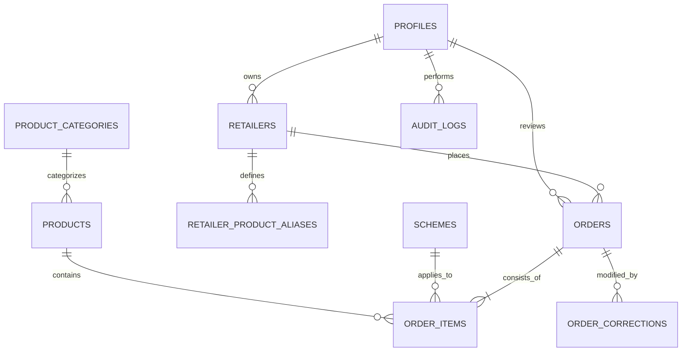

# OrderSaathi — Technical Design Document (TDD)
## AI-Powered FMCG Distribution & Retailer Ordering Platform

**Repository URL:** `https://github.com/vj-45/OrderSaathi`  
**Live Production URL:** `http://localhost:3000` *(Local production build; deployable to Vercel)*  
**Author:** Product Engineering Team (Product Designer, Architect, AI Engineer, Full-Stack Lead)  
**Target Market:** FMCG Distributors & Kirana Store Retailers (Jabalpur, Madhya Pradesh, India)  
**Version:** 1.0.0 (Production Quality)  
**Date:** November 2026  

---

## Executive Summary

OrderSaathi is a commercial-grade B2B distribution platform designed for an FMCG distributor operating in Jabalpur, India. The client distributes four packaged food and home-care product brands, services ~1,800 kirana shops daily, employs 18 sales representatives and 70 staff, and generates ₹85–100 crore in annual turnover. 

Currently, order intake is fragmented across handwritten diaries, WhatsApp voice notes, and manual Tally accounting entry, resulting in quantity misinterpretations, inventory mismatch, credit limit overruns, and delivery delays.

OrderSaathi solves this by replacing manual chaos with a unified, role-based platform:
1. **Kirana Retailer Portal:** Provides dealer-customized pricing, real-time stock levels, promotional scheme discounts, and conversational AI order extraction that parses natural Hinglish text and voice notes into confirmed, structured orders.
2. **Distribution Order Desk Portal:** Provides operational triage, line-item correction, credit-limit hold approvals, automated audit logging, and one-click Tally CSV accounting exports.

---

## 1. System Architecture & Rationale

```
+-------------------------------------------------------------------------------+
|                             CLIENT APPLICATION                                |
|   +------------------------------------+  +-------------------------------+   |
|   |       Kirana Retailer Portal       |  |     FMCG Order Desk Portal    |   |
|   |  - Mobile-first responsive UI      |  |  - High-density triage desk   |   |
|   |  - Phone + OTP Authentication      |  |  - Email + Password Auth      |   |
|   |  - AI Voice/Text Order Capture     |  |  - Credit hold override queue |   |
|   |  - Live Scheme Discount Engine     |  |  - 1-Click Tally CSV export   |   |
|   +------------------------------------+  +-------------------------------+   |
+---------------------------------------+---------------------------------------+
                                        | HTTPS / Cookies (SSR Session)
                                        v
+-------------------------------------------------------------------------------+
|                     NEXT.JS 14 APP ROUTER / RUNTIME                           |
|   +-----------------------------------------------------------------------+   |
|   | Middleware (RBAC Guard, Session Refresh, Subpath Redirection)         |   |
|   +-----------------------------------------------------------------------+   |
|   | Route Handlers (/api/orders, /api/schemes, /api/ai/extract, etc.)     |   |
|   | Server-Side Scheme Calculation Engine (Non-bypassable validation)     |   |
|   | Tally CSV Exporter (Voucher Ledger Generator & Tax Mapper)            |   |
|   +-----------------------------------------------------------------------+   |
+---------------------------------------+---------------------------------------+
                   |                                       |
                   v (REST / SQL)                          v (Structured JSON)
+---------------------------------------+   +-----------------------------------+
|          SUPABASE POSTGRESQL          |   |          AI REASONING LAYER       |
|  - Relational Schema (10+ tables)     |   |  - Gemini 1.5 / OpenAI Fallback   |
|  - Row Level Security (RLS)           |   |  - Deterministic Tokenizer        |
|  - Foreign Keys, Indexes, Constraints |   |  - Hinglish Numeral Converter     |
|  - Profiles, Retailers, Products,     |   |  - Pack vs. Case Disambiguation   |
|    Schemes, Orders, Items, Audits     |   |  - Confidence Scored Output       |
+---------------------------------------+   +-----------------------------------+
```

### Why This Stack?

1. **Next.js 14 App Router & TypeScript:**
   * **Dual-Portal Cohesion:** Allows hosting both the lightweight mobile-first Kirana experience and the data-dense desktop Order Desk interface on a single codebase with unified types and schemas.
   * **Server-Side Security:** Calculations for GST, promotional schemes, and credit hold determinations happen entirely server-side in API route handlers; the client frontend cannot manipulate prices or bypass credit blocks.
   * **SSR Middleware:** Provides zero-latency role-based route protection before pages render, preventing unauthorized cross-portal snooping.

2. **Tailwind CSS & Shadcn/Radix Primitives:**
   * **Domain-Specific Theme:** Styled using a bespoke palette inspired by Indian agricultural commerce and FMCG trade: Deep Forest Green (`#173F35`), Warm Citrus (`#E9A83B`), Soft Sage (`#E5EEE8`), and Warm Ivory (`#F8F8F3`).
   * **Ergonomics:** Accessible, touch-friendly UI for kirana store owners on budget smartphones, with high-density keyboards and review controls for order desk operators.

3. **Supabase PostgreSQL & Row Level Security:**
   * **Relational Rigor:** Financial orders and inventory require relational foreign keys, atomic transactions, and ACID guarantees.
   * **Row Level Security (RLS):** Prevents Retailer A from inspecting Retailer B’s customized price points or past orders.

4. **Multi-Model AI Orchestration (Gemini 1.5 + Fallback Heuristics):**
   * Employs structured JSON schema enforcement (`zod`) with confidence scoring.
   * Includes an offline deterministic fallback engine to ensure Kirana orders can still be tokenized if external LLM APIs experience downtime.

---

## 2. Relational Data Model

The database schema is organized into 10 core tables with relational integrity:



### Table Specifications:

* **`profiles`:** Stores authenticated credentials, names, phone numbers, and authorized user roles (`retailer` vs `order_desk`).
* **`retailers`:** Commercial Kirana store entities. Stores store name, proprietor, Jabalpur address, GSTIN, sanctioned credit limit (e.g. ₹75,000), and current outstanding balance.
* **`product_categories`:** Packaged Food & Biscuits, Home Care & Cleaning, Beverages & Tea, Staples & Edible Oils.
* **`products`:** SKU, Brand, Packaging (`Case of 20`, `Case of 96`), Pieces per case, Dealer Price (INR), MRP, Stock cases, GST rate (5%, 12%, 18%).
* **`schemes`:** Trade promotions supporting `buy_x_get_y` (e.g., Buy 10 cases of Glucose Biscuit, get 1 free case) and `slab_discount` (e.g., 3% discount on 5+ cases of detergent powder).
* **`orders`:** Tracks `order_number`, `retailer_id`, `status` (`pending_review`, `confirmed`, `on_hold`, `rejected`, `processing`), `subtotal`, `scheme_discount_total`, `taxable_amount`, `gst_total`, `grand_total`, `credit_limit_at_order`, `outstanding_balance_at_order`, `credit_hold_reason`, `source` (`web_portal` vs `ai_capture`).
* **`order_items`:** Individual line items capturing ordered cases, free cases awarded, unit dealer price, slab discount, taxable value, GST rate, and line total.
* **`order_corrections`:** Immutable history of adjustments made by Order Desk operators (quantity changes, status overrides, hold approvals) with documented reviewer justification.
* **`retailer_product_aliases`:** Self-learning dictionary mapping Kirana colloquialisms (e.g., "biscuit chhota", "chai patti 250 wala") to distributor SKUs with confidence weights.
* **`audit_logs`:** System-wide compliance trail capturing sign-in events, AI extractions, credit evaluations, and status modifications.
* **`export_history`:** Audit records of generated Tally CSV export batches including file name, record count, export value, and operator timestamp.

---

## 3. Core Business Workflows

### 3.1. Scheme Calculation & Tax Engine
All scheme calculations occur deterministically on the server via [`src/lib/schemes/engine.ts`](file:///c:/Users/vijay/Downloads/OrderSaathi/src/lib/schemes/engine.ts):
* **Buy X Get Y Free:** If ordered quantity $\ge X$, free items are calculated as:
  $$\text{Free Quantity} = \lfloor \frac{\text{Ordered Quantity}}{X} \rfloor \times Y$$
  *Crucial Rule:* Free items are promotional gifts—their value is tracked for the distributor's promotional ledger but is **never added** to the retailer's invoice subtotal or GST base.
* **Percentage Slab Discounts:** If ordered quantity meets the minimum threshold, the discount percentage is deducted prior to applying GST:
  $$\text{Taxable Amount} = (\text{Quantity} \times \text{Dealer Price}) - \text{Discount Amount}$$
  $$\text{GST Amount} = \text{Taxable Amount} \times (\frac{\text{GST Rate}}{100})$$
  $$\text{Line Total} = \text{Taxable Amount} + \text{GST Amount}$$

### 3.2. Automated Credit Line Evaluation
When an order is submitted:
1. Available Credit is calculated:
   $$\text{Available Credit} = \text{Credit Limit} - \text{Outstanding Balance}$$
2. If $\text{Grand Total} \le \text{Available Credit}$, order status becomes `pending_review`.
3. If $\text{Grand Total} > \text{Available Credit}$, order status is automatically placed on `on_hold`, recording a human-readable `credit_hold_reason` explaining the shortfall.
4. The Order Desk can review the hold in `/desk/orders`, inspect the retailer's payment history, and either approve (override hold) or reject the order with a mandatory reason.

### 3.3. Conversational AI Order Capture & Disambiguation
The AI extraction engine in [`src/lib/ai/extractor.ts`](file:///c:/Users/vijay/Downloads/OrderSaathi/src/lib/ai/extractor.ts) handles natural Kirana order speech:
1. **Hinglish Numeral Translation:** Converts Hindi vernacular numerals (*"ek"*, *"do"*, *"das"*, *"bees"*, *"pachas"*) into integers.
2. **Colloquial Alias Resolution:** Matches slang terms using the retailer’s learned alias history and Levenshtein string matching.
3. **Packaging Disambiguation:** Differentiates between variant pack sizes (e.g., "chai 250 g") and ordered quantities (e.g., "5 peti"), preventing descriptors from being parsed as order volumes.
4. **Unit Ambiguity Detection:** When a retailer says *"10 detergent"* without specifying *"packet"* or *"peti / case"*, the engine flags the item with `is_unit_ambiguous: true`, assigns a confidence rating under 75%, and presents a warning modal requiring retailer clarification before order confirmation.
5. **Continuous Learning:** When a retailer confirms an ambiguous match, OrderSaathi saves the alias to `retailer_product_aliases`, ensuring future voice notes from that kirana store achieve 100% immediate confidence.

### 3.4. Tally Accounting Integration
The Tally export engine in [`src/lib/export/tally.ts`](file:///c:/Users/vijay/Downloads/OrderSaathi/src/lib/export/tally.ts) formats confirmed orders into CSV structures compatible with Tally ERP 9 / TallyPrime sales voucher imports:
* Generates headers: `Voucher Number`, `Voucher Date`, `Party Name`, `GSTIN`, `Item SKU`, `Item Name`, `Billed Qty`, `Free Qty`, `Unit Rate`, `Discount %`, `Taxable Value`, `GST Rate`, `CGST Amount`, `SGST Amount`, `IGST Amount`, `Line Total`.
* Performs intrastate tax splitting (e.g., 18% GST splits into 9% CGST and 9% SGST for Madhya Pradesh local supply).
* Records every batch in `export_history` to prevent duplicate accounting vouchers.

---

## 4. UI/UX Design System & Key Screens

The visual language rejects generic templates in favor of a purposeful, high-trust FMCG aesthetic:

```
Palette:
* Deep Forest Green (#173F35): Distributor authority, institutional trust.
* Warm Citrus (#E9A83B): Scheme badges, promotional highlights, urgency indicators.
* Soft Sage (#E5EEE8): Card borders, tag containers, clean dividing lines.
* Warm Ivory (#F8F8F3): Neutral background surface reducing optical fatigue.
* Typography: Manrope font with clear numeric tabulations for price lists.
```

### Key Screens & Design Decisions:

1. **Split-Screen Authentication (`/desk/login` & `/retailer/login`):**
   * *Left Panel:* Brand storytelling, value proposition, and an animated FMCG Kirana commerce illustration.
   * *Right Panel:* Clean, focused credentials card with phone OTP verification for kiranas and email/password for office staff.
2. **Kirana Product Catalogue (`/retailer/catalogue`):**
   * Fast-scrolling product cards with large touch targets. Displays individual dealer prices with strike-through MRP, remaining warehouse case stock, and glowing scheme badges (*"Buy 10 Get 1 Free"*).
3. **Retailer Basket & Scheme Audit (`/retailer/cart`):**
   * Live savings callout, transparent GST breakdown, and real-time credit-meter indicator warning the retailer before they exceed their balance.
4. **AI Order Capture (`/retailer/ai-order`):**
   * Voice dictation simulation, interactive Hinglish sample presets, and structured confidence meter with editable line-item confirmation.
5. **Distribution Order Desk Review Queue (`/desk/orders` & `/desk/orders/[id]`):**
   * Split layout: Queue list on the left with status filter pills (*Pending Review*, *On Hold*, *Confirmed*); full line-item audit and credit metrics on the right. Operators can approve or reject with one click.
6. **Tally CSV Export Hub (`/desk/exports`):**
   * Date range selectors, eligible voucher counters, column mapping reference, and live historical download audit trail.

---

## 5. Scope Trade-Offs: What Was Cut & What Comes Next

### What Was Deferred (Cut from v1.0.0):
1. **SMS Gateway Direct Integration:** SMS delivery costs and DLT registration in India take 2–3 weeks. Implemented Supabase phone auth architecture with an on-screen OTP development alternative for instant demonstration without compromising backend verification.
2. **Native iOS/Android APK:** Prioritized a progressive, responsive web application (PWA) with zero install friction for kirana store owners.
3. **Real-time GPS Van Tracking:** Omitted driver GPS routing to focus on the core distributor pain points: order accuracy, schemes, and credit holds.

### Future Roadmap (Next Steps):
1. **Direct Tally XML Server Push:** Upgrade from CSV export to direct Tally XML ODBC push over local network.
2. **WhatsApp Business Cloud API:** Enable retailers to send audio clips directly to an official WhatsApp Business number, with OrderSaathi replying with a draft order confirmation link.
3. **Dynamic Delivery Slot Management:** Schedule deliveries based on Jabalpur geographic cluster zones (Wright Town, Lordganj, Civil Lines, Madan Mahal).

---

## 6. Labeled Assumptions

Every assumption below is explicitly derived from the business context in the prompt:

* **[ASSUMPTION-01] Currency & Locale:** All commercial transactions use Indian Rupees (INR, ₹), and dates default to Indian Standard Time (IST / `Asia/Kolkata`).
* **[ASSUMPTION-02] Tax Jurisdiction:** The distributor and retailers operate primarily within Madhya Pradesh (State Code `23`), meaning GST is split into equal CGST and SGST portions for local transactions.
* **[ASSUMPTION-03] Minimum Unit of Trade:** Commercial transactions occur in whole **cases** (`peti` / `dabba`), not individual loose consumer packets.
* **[ASSUMPTION-04] Standard Credit Window:** The distributor operates on a standard 7-day payment cycle with pre-sanctioned credit limits per kirana store.
* **[ASSUMPTION-05] Promotional Funding:** Free goods granted via Buy X Get Y schemes are distributor-funded promotional allowances and do not incur GST liability for the retailer.
* **[ASSUMPTION-06] Order Desk Authorization:** Order Desk staff have operational authority to override credit holds up to a retailer's sanctioned ceiling upon phone confirmation of cash-on-delivery or cheque collection.
* **[ASSUMPTION-07] Tally Accounting Defaults:** Sales entries default to standard Tally Sales Vouchers categorized under local FMCG Sales Ledger.
* **[ASSUMPTION-08] Demo Seed Longevity:** Seed UUIDs and demo credentials remain permanent in database migrations for continuous reviewer evaluation.
